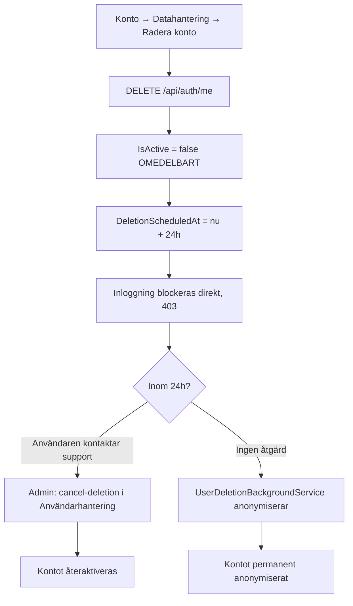

# GDPR-verktyg (export + radering)

Två separata verktyg under Konto → Datahantering: exportera all lagrad
persondata som JSON, eller radera kontot permanent.

## Status
Byggd session 33 (PR #477), efter att ha varit ren mock (bekräftelse-UI
utan backend-koppling) i flera tidigare sessioner. Verifierad live
2026-09-11 via ett kastkonto (registrera → begär radering → bekräfta
`403 Kontot är avstängt` vid nästa inloggningsförsök).

## Flöde — radering

## Teknisk plats
I appen: Konto → Datahantering (`Datahantering.tsx`).
I koden: `AuthController.ExportMe`/`DeleteMe`, samma
anonymiseringsmekanism som adminens raderingsväg
(`AdminUsersController.Delete`), `UserDeletionBackgroundService`.

## Återkommande att tänka på
- Export innehåller INTE SMS-mottagare/samtycken — de fälten finns inte i
  produkten (SMS-kanalen byggdes aldrig), inte en bugg i exporten
- Radering via admin (Användarhantering) och radering via kontot självt
  (Datahantering) delar exakt samma 24h-anonymiseringsmekanism

## Kopplade FAQ

## Kopplade funktioner
- [[Autentisering]] — `IsActive`-kollen vid inloggning
