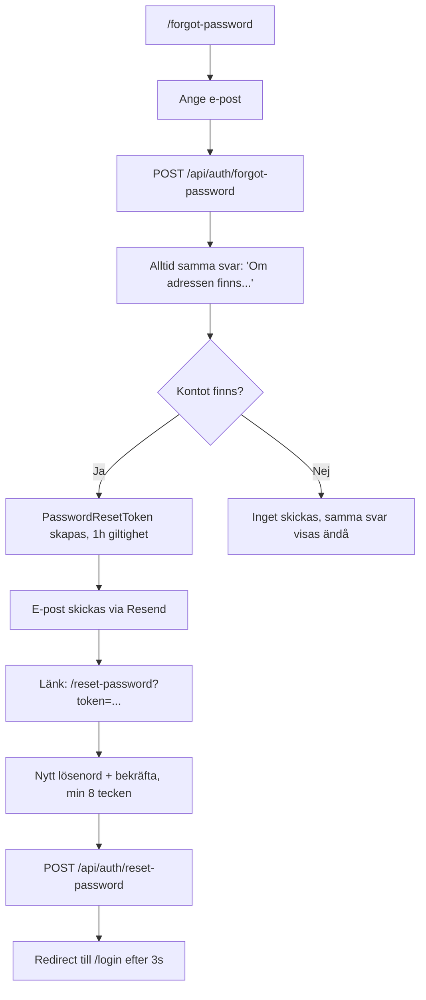

# Lösenordsåterställning

Ange e-post → återställningslänk skickas (om adressen finns, samma svar
oavsett för att inte läcka vilka e-postadresser som har konton) → klicka
länken → sätt nytt lösenord.

## Status
Byggd session 18. Verifierad live end-to-end 2026-09-12 (skickat,
mottaget i huvudinkorgen inte skräppost, länken fungerade, nytt lösenord
gick att logga in med). Del av launch-checklistans rekommenderade tester,
nu avklarad.

## Flöde

## Teknisk plats
I appen: `ForgotPasswordPage.tsx`, `ResetPasswordPage.tsx`.
I koden: `PasswordResetToken`-modellen, samma Resend-baserade
e-postutskick som [[Autentisering]] och [[GDPR-verktyg]].

## Kopplade FAQ

## Kopplade funktioner
- [[Autentisering]]
