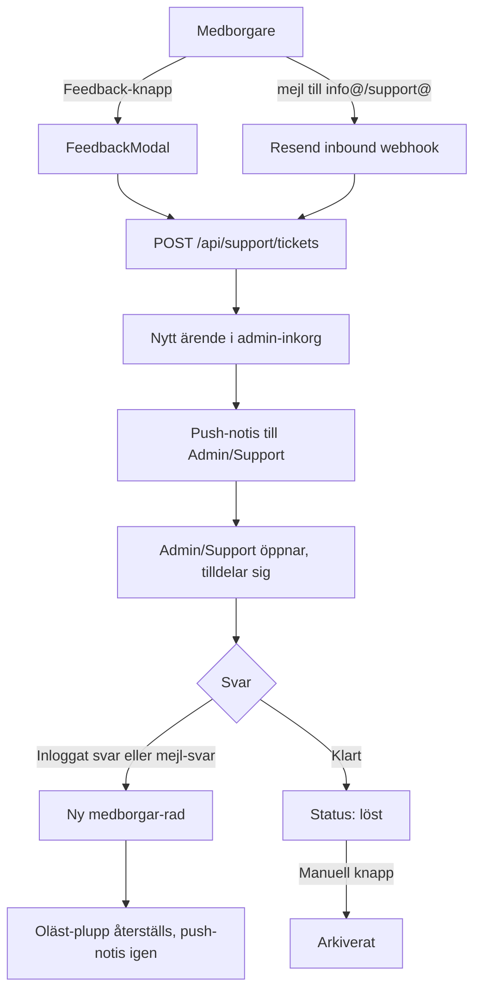

# Support-inbox (ärendehantering)

Medborgare kontaktar support via Feedback-knappen eller mejl till
info@/support@ (Resend inbound) — allt hamnar i samma admin-inkorg med
konversation, interna anteckningar, tilldelning, arkivering, och
push-/oläst-notiser.

## Status
Den mest utbyggda enskilda funktionen i hela adminpanelen, byggd i lager
över många sessioner: grundinbox → interna noter → tilldelning →
påminnelser → schemalagda åtgärder → arkiv+oläst-indikatorer (session 30)
→ Resend inbound-mejl som riktig tvåvägskonversation utan Zoho (session
43-45, fyra buggfixar) → push-notis+oläst-plupp vid nya svar (session 45).

## Flöde

## Teknisk plats
I appen: Adminpanel → Support-inbox, Konto → Support.
I koden: `SupportInbox.tsx`, `SupportController.cs`,
`WebhooksController.ResendInbound`, `SupportTicket`/`SupportTicketMessage`.

## Återkommande att tänka på
- `LastViewedAt`/`LastUserMessageAt` styr oläst-status (inte den gamla
  `FirstOpenedAt`, som bara mätte "öppnad NÅGONSIN") — ett nytt
  medborgarsvar på ett redan öppnat ärende gör det oläst igen
- Se `fallgropar` för de tre avvikelserna från ursprungsspecen

## Kopplade FAQ

## Kopplade funktioner
- [[Adminpanel-roller]]
- [[../Verktyg/GitHub-issues-granskning-2026-09-12|Arkiverings-frågan (#111)]]
