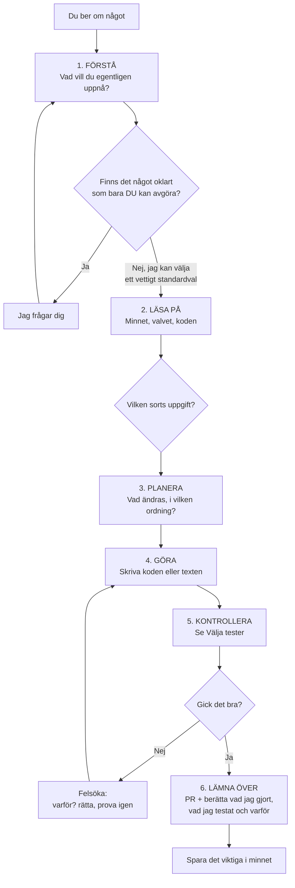

# 0. Grundflödet

Det här skelettet gäller **alla** uppgifter. Varianterna (t.ex. [[Ny funktion]]) bygger på det.

## Med enkla ord

| Steg | Liknelse | Vad det betyder |
|---|---|---|
| 1. Förstå | En hantverkare frågar "vad ska rummet användas till?" innan hen börjar | Jag tar reda på *målet*, inte bara orden i frågan |
| Fråga eller inte? | Hantverkaren frågar inte om varje skruv, bara om färgen på väggen | Jag frågar bara om det som är *ditt* beslut. Resten väljer jag själv och berättar om |
| 2. Läsa på | Läsa ritningen innan man river en vägg | Jag kollar vad som redan finns, så jag inte bygger dubbelt eller förstör något |
| Vilken sorts uppgift? | Soppa eller tårta? | Här väljs vilken variant som gäller. Den avgör hur stora stegen 3–5 blir |
| 3. Planera | Mäta två gånger, såga en gång | Bestämma vilka filer som ändras och i vilken ordning |
| 4. Göra | Själva sågandet | Skriva kod eller text |
| 5. Kontrollera | Smaka på maten innan den serveras | Kolla att det fungerar och att inget annat gått sönder |
| Felsöka | Mekanikern som byter en del i taget tills ljudet försvinner | Utesluta orsaker en i taget, inte gissa vilt |
| 6. Lämna över | Visa kunden runt i det färdiga rummet | Berätta vad jag gjorde, vad jag testade och varför |

## Var stegen skiljer sig mellan uppgifter

| Uppgift | Stort steg | Litet/borttaget steg |
|---|---|---|
| Ny funktion | Alla steg, mest *planera* och *kontrollera* | Inget |
| Buggfix | *Läsa på* (hitta orsaken) | *Planera* (ändringen är oftast liten) |
| Code review | *Läsa på* | *Göra* finns knappt, jag läser bara |
| Bara dokumentation | *Göra* | *Kontrollera* är bara korrekturläsning, och det går direkt till main utan PR |
| Något som syns på skärmen | *Kontrollera* (titta på sidan, mörkt läge, mobil) | |
| Något med databasen | *Planera* + *kontrollera* (migrationer är svåra att ångra) | |

Se [[Välja tester]] för hur steg 5 avgörs.
