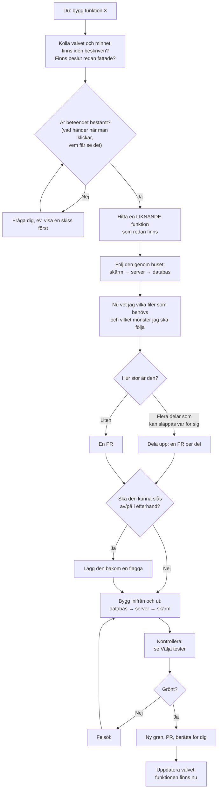

# Ny funktion

Variant av [[0. Grundflödet]]. Här är alla steg stora, eftersom något helt nytt ska in i ett hus som redan står.

## Med enkla ord

- **Hitta en liknande funktion.** Det viktigaste steget. Ska jag bygga ett nytt rum tittar jag först på hur de andra rummen är byggda, så det nya ser ut som resten av huset. Jag läser inte alla filer, bara de som hör till "grannfunktionen".
- **Följ den genom huset.** En funktion går oftast genom tre våningar: det du ser (skärmen), det som tar emot och bestämmer (servern) och det som minns (databasen). Följer jag grannfunktionen genom alla tre vet jag vilka filer jag behöver.
- **När har jag läst tillräckligt?** När jag kan säga "jag ska ändra de här filerna, på det här sättet, och det här kommer inte påverkas". Kan jag inte säga det läser jag mer.
- **En PR per del.** Hellre tre små paket som kan granskas och ångras var för sig än ett jättepaket.
- **Inifrån och ut.** Grunden först, sedan väggarna, sist tapeten. Då finns det alltid något att stå på.

← [[0. Grundflödet]] · [[Välja tester]] · [[_Start|Hur Claude jobbar]]
