# Välja tester

**Grundregel:** ju svårare något är att ångra, och ju fler det påverkar, desto mer kontrollerar jag.
En stavfelsrättning kontrolleras lite. En ändring i databasen kontrolleras mycket.

Jag ställer frågorna nedan till mig själv, uppifrån och ner. Varje "ja" lägger till en kontroll.

```mermaid
flowchart TD
    S["Jag har ändrat något"] --> A["ALLTID:<br/>Går det att bygga?<br/>(startar bilen?)"]
    A --> B["ALLTID:<br/>Är de gamla testerna fortfarande gröna?<br/>(gick något ANNAT sönder?)"]
    B --> Q1{"Är det en buggfix?"}
    Q1 -- "Ja" --> R1["Först ett test som VISAR felet,<br/>sen laga, sen se testet bli grönt"]
    Q1 -- "Nej" --> Q2
    R1 --> Q2{"Ändrade jag något som<br/>räknar eller bestämmer?<br/>(logik)"}
    Q2 -- "Ja" --> R2["Nytt test för just den logiken,<br/>även konstiga fall:<br/>tomt, noll, jättemånga"]
    Q2 -- "Nej" --> Q3
    R2 --> Q3{"Rör det databasen?"}
    Q3 -- "Ja" --> R3["Kolla att migrationen funkar<br/>i produktionens databas,<br/>inte bara lokalt"]
    Q3 -- "Nej" --> Q4
    R3 --> Q4{"Syns det på skärmen?"}
    Q4 -- "Ja" --> R4["Kodstil-koll (lint)<br/>+ titta på sidan:<br/>ljust/mörkt läge, mobil"]
    Q4 -- "Nej" --> Q5
    R4 --> Q5{"Styrs det av en<br/>av/på-knapp (flagga)?"}
    Q5 -- "Ja" --> R5["Testa både AV och PÅ<br/>+ kolla vad den faktiskt<br/>står på i produktion"]
    Q5 -- "Nej" --> Q6
    R5 --> Q6{"Beror det på vem<br/>som är inloggad?"}
    Q6 -- "Ja" --> R6["Testa som gäst,<br/>vanlig användare och admin"]
    Q6 -- "Nej" --> KLAR
    R6 --> KLAR["Klart att lämna över.<br/>Jag berättar vilka kontroller<br/>jag gjorde och varför"]
```

## Med enkla ord

- **Går det att bygga?** Som att vrida om nyckeln. Startar inte bilen spelar inget annat någon roll.
- **Gamla tester gröna?** Man lagar en kran och ser till att det inte börjat läcka någon annanstans.
- **Buggfix: visa felet först.** Som att få bilen att låta igen inför mekanikern. Annars vet man inte om man lagade rätt sak.
- **Konstiga fall.** En våg testas inte bara med 1 kg, utan också med ingenting på och med för mycket.
- **Databasen.** Projektet har lärt sig den hårda vägen att en databas kan fungera lokalt men krascha i produktion. Därför finns en extra regel här.
- **Titta på sidan.** Koden kan vara rätt men knappen hamna under menyn. Det syns bara om man tittar.
- **Av/på-knappar.** Det räcker inte att veta vad knappen *borde* stå på. Jag kollar vad den *faktiskt* står på.
- **Olika användare.** En dörr kan vara låst för gäster men öppen för admin. Båda måste stämma.

## Var reglerna kommer ifrån
Flera av frågorna finns för att något gick fel tidigare i projektet och det blev en regel i minnet,
t.ex. databasregeln och regeln om att kolla flaggans faktiska läge.

← [[0. Grundflödet]] · [[_Start|Hur Claude jobbar]]
